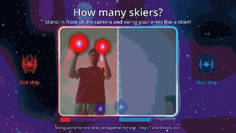

# ergo-chaos

**Ergo Chaos is a free video game for children which they play by swinging their arms like cross-country skiers in front of a webcam, instead of sitting still with a controller.**

We made it so that kids can practice the arm work of cross-country skiing (the poling) at home, and have fun while doing it.
One player, or two players together side by side, fly spaceships through six levels full of goo, lasers and unicorns.

## How it works

The webcam watches your hands.
Each spaceship has two engines, a left one and a right one, and **your arms are the engines**:

* Swing your left arm up and down, and the left engine runs.
  Swing your right arm, and the right engine runs.
* The faster you swing, the stronger the engine.
  Swing both arms equally fast, and the ship flies straight ahead.
* Swing one arm faster than the other, and the ship turns: a faster right arm turns it to the right, a faster left arm to the left.
* Stop swinging, and the ship stops.

So to fly well, you have to keep a steady rhythm with both arms, just like when you push yourself forward with the ski poles.
The speedometers in the corners of the screen show how fast each arm, and so each engine, is going, and the little fireballs on the camera picture show where the game sees your hands.

The game only looks at how fast your hands move up and down.
It does not look at your legs, your skis or your poles, so you can play standing on the floor, holding real poles, or on a ski trainer, as long as the camera sees your upper body and both hands.

### One or two players

At the start, the game asks: "How many skiers?"
Stand in front of the camera and swing your arms.
If only one of you swings, you play alone; if both of you swing, you play together.
You can also press 1 or 2 on the keyboard.

When you play alone, you fly the red ship on the whole screen, wherever you stand in front of the camera.

When you play together, the camera picture is split in the middle.
The player on the left side (as you see yourselves on the screen) flies the red ship, and the player on the right side flies the blue ship.
The screen is split as well, so that each player always sees their own ship, and the camera picture sits right where the screen is split.

You win or lose together:

* **Collect all the goo** (the yellow splats) on the level.
  It does not matter which ship collects it; the counter at the top counts the goo of both.
* **Do not run out of battery.**
  Flying uses up the battery, and the dangers of the level drain it even faster.
  Park on a recharge pad to fill it up again.
  If the battery of either ship runs empty, the mission fails, and you both try the level again.

On some levels you can only get through if you help each other: one ship holds a switch open while the other one flies through the gate.

Nothing in the game gets destroyed.
The dangers only drain the battery, and a failed mission simply starts over after a short countdown.

### The levels

1. **Playground** gets you used to flying: collect the goo, fly through the laser gates while their lights are green (they zap you when they turn red), and recharge on the pad.
2. **Roundabout** adds walls and rings of rotating fireballs, which you have to slip through.
3. **Switcher** has gates which open only while a ship sits on one of their pads, so one ship holds the gate open for the other. When you play alone, the gate stays open for 10 seconds after you leave the pad (its lights turn yellow), so hurry through!
4. **Pit** is full of robots which wander around and shove your ships aside.
5. **Chase** sends a villain after each of you. When it catches you, it drains your battery, then it stops for a moment, so run!
6. **Stable** is the reward at the end: friendly unicorns wander around and fill up your battery when you touch them.

On every level, the fields of sparks along the borders drain the battery, so keep away from them.
After the last level, the game starts again from the first one.

**No network access.**
The game runs entirely on your computer and works offline.
The webcam images are processed locally, in memory, and are never saved or sent anywhere.

## Download

There are no release packages yet.
Until then, build and export the game yourself; see [CONTRIBUTING.md](CONTRIBUTING.md).

You need a webcam which supports 640x480 in the YUYV format.
If you have more than one such camera, the game asks you which one to use.
Without one, it explains the problem and quits on any key.

Press Escape twice to quit.

## Acknowledgments

We find the hands and the heads with [YOLOX-Body-Head-Hand] by PINTO0309 (Apache-2.0), based on [YOLOX] by Megvii.
We run it with [ONNX Runtime].

[YOLOX-Body-Head-Hand]: https://github.com/PINTO0309/PINTO_model_zoo/tree/main/426_YOLOX-Body-Head-Hand
[YOLOX]: https://github.com/Megvii-BaseDetection/YOLOX
[ONNX Runtime]: https://github.com/microsoft/onnxruntime

The smoothing of the hands and the speed of the arms were adapted from our earlier demo, [body-pose-estimation-with-godot].

[body-pose-estimation-with-godot]: https://github.com/mristin/body-pose-estimation-with-godot

The images were taken from:

* Speedometer: https://opengameart.org/content/speedometer-0
* Spaceship: https://opengameart.org/content/spaceships-1
* Goo: https://kenney.nl/assets/yellow-paint-pack

See [THIRD_PARTY.md](THIRD_PARTY.md) for the details.

## License

Ergo Chaos is licensed under the [Apache License 2.0](LICENSE).
The third-party components, e.g., Godot Engine, ONNX Runtime, the hand detection model and the images, keep their own licenses; see [THIRD_PARTY.md](THIRD_PARTY.md).

## Contributing

See [CONTRIBUTING.md](CONTRIBUTING.md) for how to set up the development environment, how to test the levels in isolation with the keyboard, and how to format the code.
